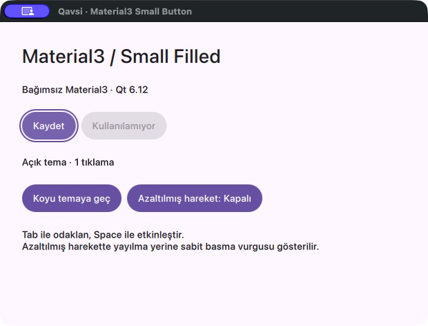
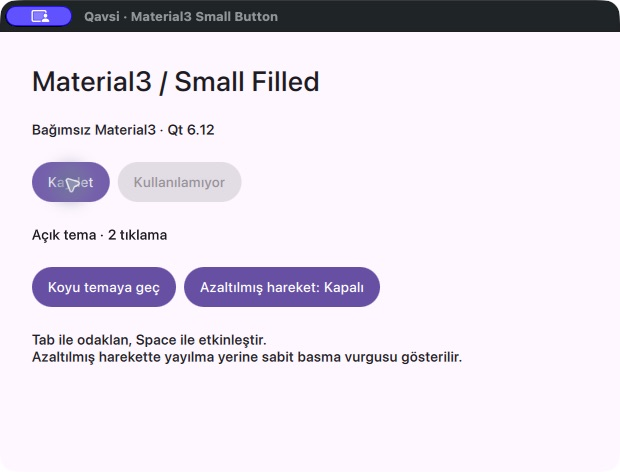
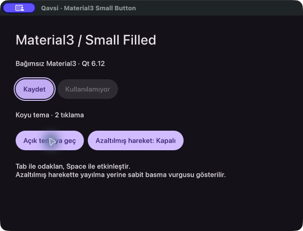
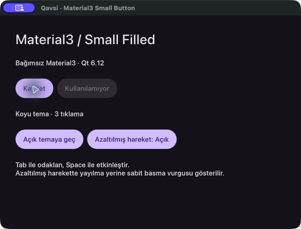

# Small Button shader / painter — aktarım öncesi tarihsel doğrulama

Bu belge 2026-10-25 tarihindeki ilk prototip çalıştırmalarının özetidir; yeni
bağımsız repo konumunda yeniden test yapılmış sayılmaz. Makineye özgü ham loglar,
geçersiz/smoke koşuları ve eski tekrar görüntüleri public ilk commit kapsamına
alınmadı; orijinal çalışma klasöründe korundu. Kendi benchmark özeti ve uygulama
penceresiyle sınırlı dört görüntü aşağıda korunur.

Yeni repo source/installed kabulü ayrı [EXTRACTION.md](EXTRACTION.md) raporunda
kaydedilir.


**Sonuç:** Bağımsız Small Filled, Metal shader ve software painter yollarıyla
doğrulandı. Source/installed, tema, input, klavye focus'u ve reduced motion
korunuyor. Commit/push yapılmadı; Qt SDK'sı değiştirilmedi.

Bu sonuç yalnız ilk normal text-only Small Filled dilimidir; tam Material3
coverage veya stable SDK beyanı değildir.

## Ortam

Qt **6.12.0**, macOS **26.5.2 arm64**, Apple M4 (Mac16,10), **16 GiB RAM**,
AppleClang **21.0.0.21000101**, CMake **4.4.3**, Ninja.
CMake 3.30 minimumu tanımlıdır; 3.30 binary'si ayrıca sınanmadı.

## Build ve davranış sonuçları

| Kontrol | Sonuç | Kanıt |
|---|---|---|
| Yalnız kit build/install | PASS | Örnek kapalı; Qt ShaderTools ile .qsb Style backing library'sine gömülü |
| Source consumer | PASS | add_subdirectory + aynı public CMake target |
| Relocated installed consumer | PASS | Taşınmış prefix; find_package; source/Merce/Runtime import yolu yok |
| Source offscreen/software | 118 assertion, 0 failure | Log — `shader-source-offscreen-software.log` (tarihsel ham log) |
| Installed offscreen/software | 118 assertion, 0 failure | Log — `shader-installed-offscreen-software.log` (tarihsel ham log) |
| Source gerçek Cocoa/Metal | 122 assertion, 0 failure | Log — `shader-source-metal.log` (tarihsel ham log) |
| Installed gerçek Cocoa/Metal | 122 assertion, 0 failure | Log — `shader-installed-metal.log` (tarihsel ham log) |
| Source gerçek Cocoa/software | 120 assertion, 0 failure | Log — `shader-source-cocoa-software.log` (tarihsel ham log) |
| Installed gerçek Cocoa/software | 120 assertion, 0 failure | Log — `shader-installed-cocoa-software.log` (tarihsel ham log) |
| Strict qmllint | PASS, 0 warning | Source Theme/Style/example; installed example; Release example |
| Paket/link sınırı | PASS | Qt/sistem + kendi Theme/Style; installed CMake export'larında source/build/Merce/Runtime/ShaderTools bağımlılığı yok |
| QML Preview MCP | PASS | Güncel Debug executable ile sol ekranda yeniden başlatıldı |
| Canlı UI | PASS | Space, Tab/Backtab, koordinatla mouse, açık/koyu tema ve reduced motion |

Sayım assertion sayısıdır. Native koşumlarda exposed/active pencere için iki ek
assertion; Metal'de shader durumu ve logu için iki ek assertion vardır.

Kontroller: Small geometri ve Label Large; hover/press/disabled; native pointer ve
Space ile tek activation; gerçek Tab/Backtab zinciri ve dış focus ring pikseli;
mouse focus'unda halkanın kalkması; pointer origin ve klavyede merkezden ripple;
yakın/uzak ripple pikselleri ve rounded clip; release/cancel/disable/hide;
held press sırasında theme değişiminde aynı delegate/renderer; OS public motion
tercihi, caller reduced motion ve aktif animasyonda politika değişimi; sıfır font
tracking/padding/spacing ve canlı caller font/width/padding bağları; tekrar
tıklamada sabit QObject sayısı ve QML uyarısı olmaması.

Native testler sırayla, offscreen kontroller bağımsız çalıştı. Tamamen örtülen
Metal penceresi frame saatini durdurabildiği için native test kendi sol ekran
penceresini active/exposed tutar.

## Renderer ve paketleme

Gerçek GraphicsInfo.Metal seçildiğinde tek ShaderEffect, diğer backend'lerde
QQuickPaintedItem::Image painter yüklenir. Controller ve input sahibi değişmez.
Dış focus halkası iki yolda aynı native Rectangle'dır. Shader yükleme/reflection
hatası loglanıp painter'a düşer; GPU pipeline hatalarının tamamı Qt status alanına
yansıma garantisi taşımaz. Software yolu shadersız sınandı.

qt_add_shaders .frag kaynağını build sırasında qsb ile derler; SPIR-V/GLSL/HLSL/MSL
paketi Style backing library resource'undadır. Installed consumer'a shader
kaynağı veya ShaderTools kurulumu gerekmez. Configure sırasında
CMAKE_DISABLE_FIND_PACKAGE_Qt6ShaderTools=ON verilmesi tüketimi engellemedi
(değişkenin kullanılmaması, consumer'ın bu paketi aramadığını da gösterdi).

```text
source consumer:       /private/tmp/qavsi-material3-source
library-only package:  /private/tmp/qavsi-material3-shader-package
ilk install prefix:    /private/tmp/qavsi-material3-shader-stage
taşınmış prefix:       /private/tmp/qavsi-material3-shader-relocated
installed consumer:    /private/tmp/qavsi-material3-shader-installed
Release ölçüm build'i: /private/tmp/qavsi-material3-shader-release
```

Installed consumer'a QAVSI_MATERIAL3_SOURCE verilmedi. İlk prefix taşındığından
yoktu; runtime import environment değişkeni ayarlanmadı. Bu, bütün Qt SDK'sının
deployment testi değildir.

## Performans

Aynı **Metal**, Release, sol **VA2419 Series**, DPR 1, 60 Hz, 1640×1000 pencere.
Sahne 1/100/400 adet 72×40 feedback yüzeyi içerir; metin, native kontrol ve
kontrol başına controller maliyeti içermez. Aynı production shader/painter,
300 ms OutCubic genişleme ve 180 ms fade girdileri kullanılır.

Önce her hücrenin sayısı/boyutu/görünürlüğü ile gerçek idle, pressed ve köşe
pikselleri kontrol edildi. Sonra yaklaşık 2 saniye ısınma ve 5 saniye örnek;
ilk turun ters sıralamasıyla ikinci tur. Aşağıdaki değerler iki koşunun aritmetik
ortalamalarıdır.

| Eşzamanlı ripple | Shader CPU/frame | Painter CPU/frame | CPU azalması | Shader / painter FPS |
|---|---:|---:|---:|---:|
| 1 | 0,96 ms | 1,23 ms | %22,1 | 52,6 / 52,3 |
| 100 | 1,81 ms | 8,41 ms | %78,5 | 52,1 / 50,9 |
| 400 | 4,59 ms | 28,06 ms | %83,6 | 51,9 / 31,2 |

[12 koşunun metrikleri, metadata ve özet JSON](benchmark-results.json).

CPU, bütün sürecin CPU süresidir; FPS ve frame aralıkları render thread'in
frameSwapped sinyalinden gelir. VSync/compositor/diğer masaüstü yükü nedeniyle
tek yüzeyde FPS üstünlüğü veya garantili 60 FPS iddia edilmez. Çoklu yüzeyde
CPU/texture upload yükünün azalması gözlendi. GPU süresi, güç tüketimi ve bellek
ayrı ölçülmedi; bu oranlar tam uygulamaya doğrudan taşınmaz.

### Qt 6.12 shader status cache sınırı

Aynı qsb URL'si sonraki instance'larda cache hit olur; ShaderInfo kopyalanırken
manager'ın varsayılan Uncompiled durumu Compiled'a geçirilmez.
[Cache-hit yolu](https://github.com/qt/qtdeclarative/blob/v6.12.0/src/quick/items/qquickshadereffect.cpp#L1168),
[varsayılan durum](https://github.com/qt/qtdeclarative/blob/v6.12.0/src/quick/scenegraph/qsgrhishadereffectnode_p.h#L113),
[Compiled ataması](https://github.com/qt/qtdeclarative/blob/v6.12.0/src/quick/scenegraph/qsgrhishadereffectnode.cpp#L866).

100/400 shader sahnesinde 1 Compiled, 99/399 cached Uncompiled ölçüldü; bütün
hücreler doğru ripple pikselini çizdi. Benchmark cold süreçte en az bir Compiled,
her instance'ta Error/log bulunmaması ve bütün hücrelerde gerçek pixel değişimi
ister. SDK patch'i, zoraki status yazımı veya görünmeyen yüzeyleri sayma yoktur.

İlk geçersiz hazırlık koşuları sonuçlara katılmadı:
render öncesi status kontrolü — `benchmark-invalid-shader-100-uncompiled.log` (tarihsel ham log),
cache status tanısı — `benchmark-invalid-shader-100-cache-status.log` (tarihsel ham log).
Smoke logları ve önceki ripple logları tarihsel kanıttır; 12 nihai ölçüme katılmaz.

## Sol ekranda çalışan UI

Pencere sol ekrana public QScreen availableGeometry üzerinden yerleşir:
QRect(-1920,30 1920x1050); normal örnek QRect(-1270,335 620x440).
Yeniden yüklemede de başlangıç rect girdisiyle bu yerleşim korunur.
QML Preview, koyu tema ve manuel reduced motion kapalı durumda açık bırakıldı.









Örnek uygulama Qt::TabFocusAllControls kullanır; macOS sistem tercihi
değiştirilmedi. Gerçek OS motion tercihi okunur; bu tur OS ayarı açılıp kapatılmadı.

## Açık sınırlar

- Yalnız normal text-only Small Filled; loading/icons/diğer boyut ve appearance'lar yok.
- Roboto paketlenmez; exact 20 px line-height, shape morph ve 48 px touch alanı yok.
  [DESIGN.md](../DESIGN.md) Qt uyarlamalarını açıklar.
- Shader/painter kenar AA'sı rasterizer nedeniyle küçük piksel farkları gösterebilir.
- StyleKit Labs ve dynamic variation hatası sürüyor; örnek variation listesi değiştirmez.
- Windows/Linux/WASM, static Qt, deployment/signing ve bütün kit coverage'ı sınanmadı.
- SDK optional QmlAssetDownloader/Qt6TaskTree configure uyarısı mevcut; kullanılan
  hedefleri engellemedi. Offscreen Sans Serif alias uyarısı Cocoa'da yoktur.
- Merce'nin mevcut kontrol/stil dosyaları, MButton ve SDK korunur.
